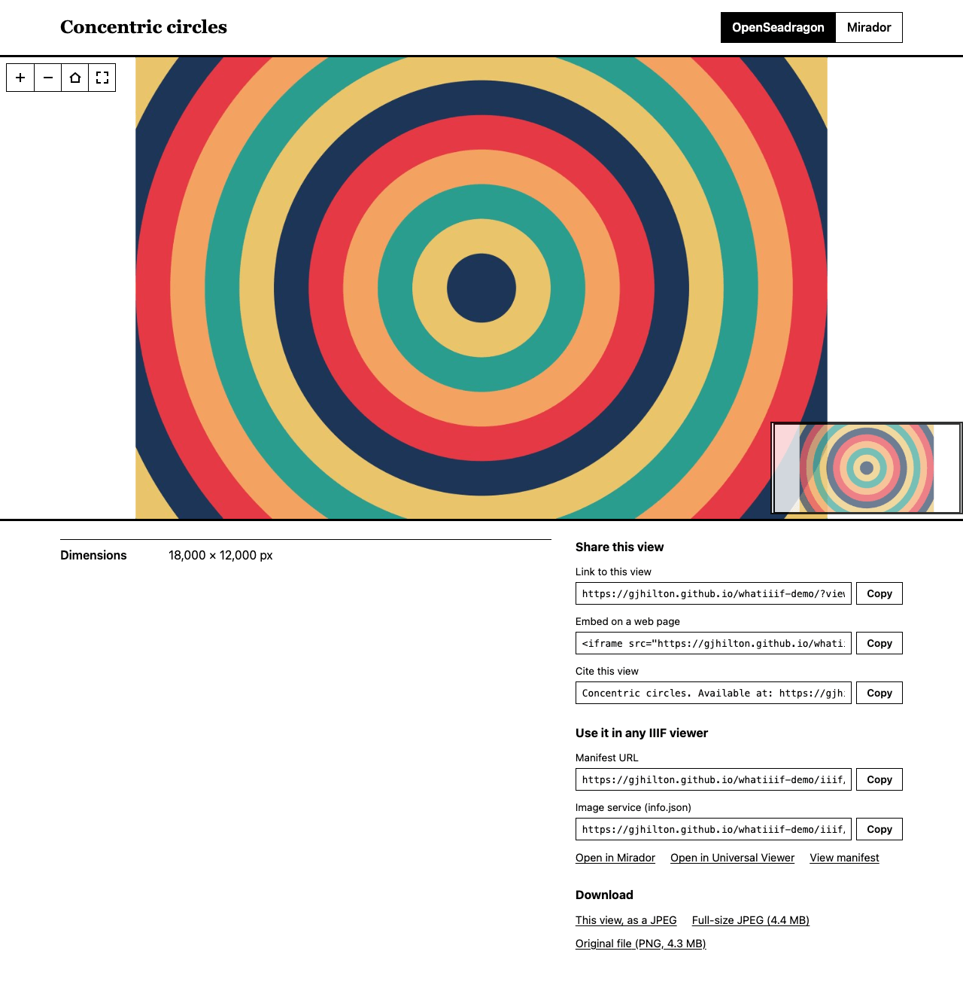
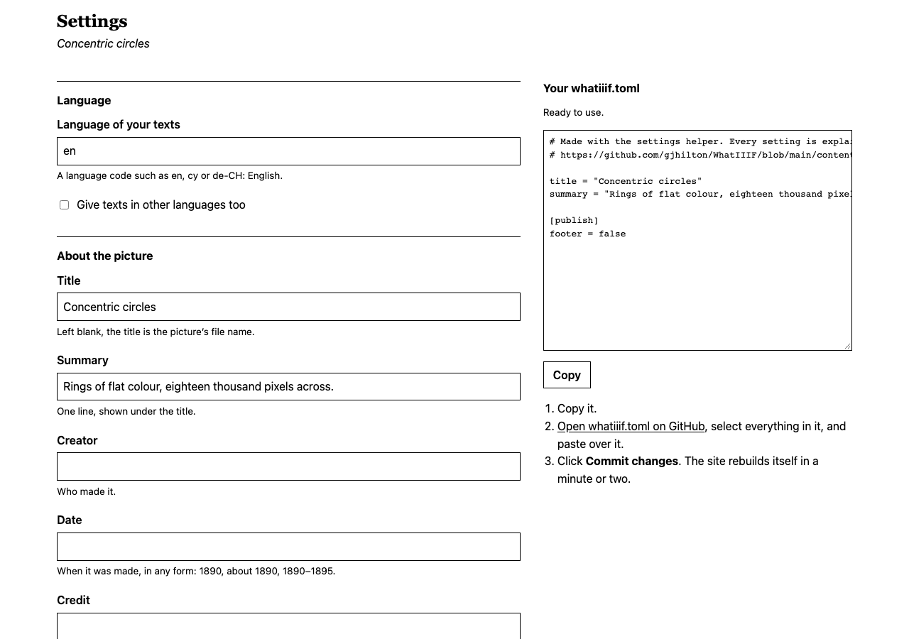
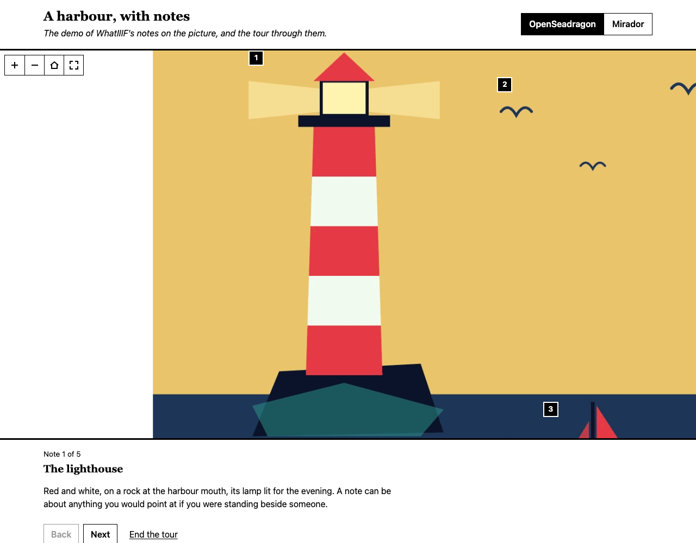
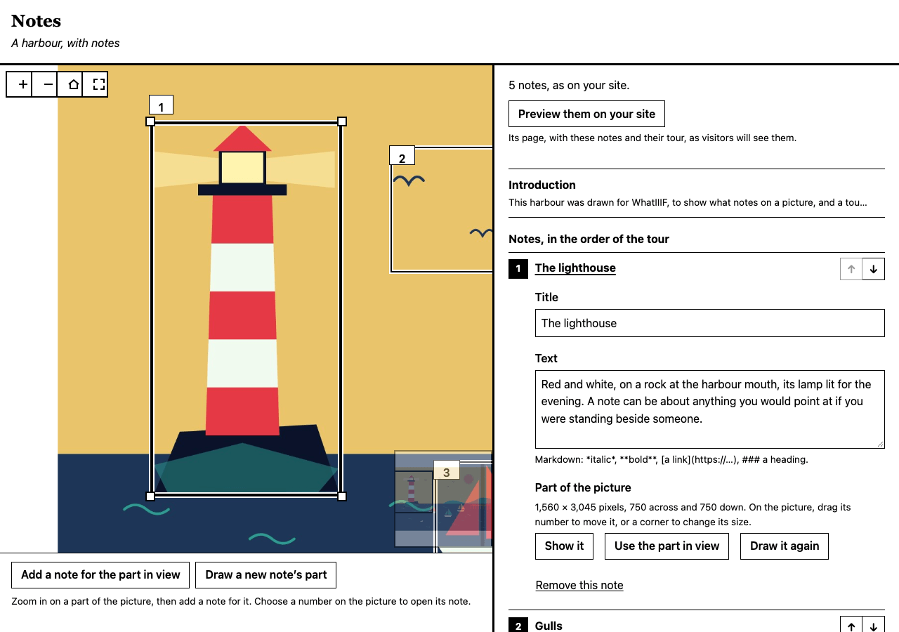

# 

**See the demo: [gjhilton.github.io/whatiiif-demo](https://gjhilton.github.io/whatiiif-demo/)**

Put one large picture on the web, zoomable, for free: a map, a manuscript page, a painting, a photograph.
You upload the image to GitHub, and GitHub builds a website where anyone can zoom into it, share a link to any
detail, or embed it in their own page. The picture is also published as [IIIF](https://iiif.io), the standard
that museum and library viewers such as Mirador and Universal Viewer read.

You need a free GitHub account, and nothing else: everything below happens in your web browser.

**New here?** The [Quickstart](docs/QUICKSTART.md) puts your picture online in five steps. **Using an AI assistant?**
Give it [WhatIIIF for LLMs](docs/FOR-LLMS.md), and it can make your site for you.

## Contents

- [Brochure](#brochure)
  - [Overview](#overview)
  - [Features](#features)
- [Owner's manual](#owners-manual)
  - [Getting started](#getting-started)
  - [Common tasks](#common-tasks): [describe your picture](#describe-your-picture), [share it](#share-it),
    [change the picture](#change-the-picture), [turn off "Published with WhatIIIF"](#turn-off-published-with-whatiiif),
    [keep up to date](#keep-up-to-date)
  - [Accessibility](#accessibility)
  - [Advanced options](#advanced-options): [languages and colours](#languages-and-colours),
    [notes on the picture, and a tour](#notes-on-the-picture-and-a-tour), [large pictures](#large-pictures)
  - [Troubleshooting](#troubleshooting)
- [FAQ](#faq)

> [!CAUTION]
> **No warranty.** WhatIIIF is free software, provided "as is", without warranty of any kind, express or implied. Its
> authors are not liable for any claim, damages or other liability arising from its use. The [MIT licence](LICENSE)
> gives these terms in full. In particular:
>
> - **Keep your own copy of every picture you publish:** nothing here backs anything up.
> - **You are responsible** for having the right to publish what you upload, and for what your site says.
> - **A site depends on GitHub,** whose services, limits and terms can change at any time.

## Brochure

### Overview

<picture>
  <source media="(prefers-color-scheme: dark)" srcset="engine/artwork/demo-dark.png">
  
</picture>

*The [demo site](https://gjhilton.github.io/whatiiif-demo/), light or dark to match how you are reading this.*

How it works:

1. You copy this template, which makes a repository of your own on GitHub, and upload your picture to it.
2. GitHub builds your site in a minute or two: the picture cut into tiles for deep zoom, its IIIF manifest, and a page
   to see it on.
3. GitHub Pages publishes it, free, at `https://YOUR-USERNAME.github.io/YOUR-REPOSITORY/`.

### Features

#### For people looking at your picture

| Feature | What it means |
|---|---|
| **Deep zoom** | From the whole picture down to every pixel, in [OpenSeadragon](https://openseadragon.github.io) or [Mirador](https://projectmirador.org). They can switch between the two. |
| **Links to details** | A link to exactly the part they have zoomed into. In OpenSeadragon, whoever opens it sees that part outlined for a moment. |
| **Embedding** | Code that puts the zoomable picture into a blog post or another website. It fits narrow screens and, in OpenSeadragon, lets readers scroll on past it. |
| **Citing** | A citation of the view on screen: who made the picture and when, its title, credit and link, and the day it was viewed. |
| **Downloads** | The view on screen as a JPEG, the full-size JPEG, and your original file, each with its size. You can switch off the last two. |
| **Real size** | A scale bar in OpenSeadragon, if you give the size of the original. |
| **Their language** | Your texts in every language you write them in. Visitors see their own and can switch. |
| **Light or dark** | Black on white, or white on black if their computer is set to dark mode; or your own colours. |
| **Any screen, and paper** | Works on phones and in Safari. Printed, it shows the view on screen, the details and the citation. Without JavaScript, it still shows the picture. |
| **Accessibility** | Alternative text for people who cannot see the picture, and every page checked automatically against the WCAG 2.2 AA guidelines ([Accessibility](#accessibility) says more). |
| **Link previews** | Links shared on social media and in chat apps show the picture, its title and summary. Search engines are told its credit and licence. |

#### For you

| Feature | What it means |
|---|---|
| **Free** | No server and no cost: GitHub builds the site and hosts it. |
| **All in the browser** | Upload a TIFF, PNG, JPEG, WebP, AVIF or GIF, of up to 2 GB ([Large pictures](#large-pictures) shows how). |
| **A settings helper** | A form on your site that writes your settings for you, and checks them as the build will. |
| **Big pictures fit** | If the site would be too big for GitHub Pages, the full-size JPEG is left out and, if need be, the tiles are made at a lower JPEG quality, to make room. |
| **Photos handled with care** | Turned the right way up, their colours kept true, and the camera's and location details left out. |
| **Your words** | A title, summary, creator, date, credit, licence, real size and any other details you like, and a description that can link to parts of the picture. |
| **Plain-English mistakes** | A mistake is explained in a sentence at the top of the page of the build that found it, and so is anything worth a look. |
| **Updates** | Improvements arrive by themselves, or as a pull request for you to merge. Your picture and settings are never touched. |
| **IIIF** | The picture is published as a [IIIF](https://iiif.io) image service and manifest, so it opens in any IIIF viewer. |

**Later, if you want them:** [notes on the picture, and a tour](#notes-on-the-picture-and-a-tour) that visitors
can step through, written with your site's notes helper. Your site does not need them, and you can add them at any time.

## Owner's manual

### Getting started

The [Quickstart](docs/QUICKSTART.md) has these steps at their shortest.

1. **Copy this template.** At the top of this page click **Use this template → Create a new repository**.
   Give it a name (it becomes part of your site's address), choose **Public**, and click **Create repository**.
2. **Switch on GitHub Pages.** In your new repository open **Settings → Pages**. Under **Source**, choose
   **GitHub Actions**.
3. **Add your picture.** Go to the **Code** tab, open the **content** folder, and choose
   **Add file → Upload files**. Drop in one TIFF, PNG or JPEG (WebP, AVIF and GIF work too), then click
   **Commit changes**.
4. **Wait a minute or two.** The **Actions** tab shows your site being built. A green tick means it is ready.
5. **Visit your site** at `https://YOUR-USERNAME.github.io/YOUR-REPOSITORY/`. The address is also shown under
   **Settings → Pages**.

The browser uploads files of up to 25 MB. For a bigger picture, see [Large pictures](#large-pictures).

### Common tasks

#### Describe your picture

The easiest way is your site's **settings helper**, at `https://YOUR-USERNAME.github.io/YOUR-REPOSITORY/settings.html`
once your site has been built. Fill in the form, copy what it makes, and paste it over `content/whatiiif.toml` on GitHub: the helper links to the
file, and checks everything as the build will. It starts from your site's settings as they are.



Or edit the file yourself: open `content/whatiiif.toml`, click the pencil icon to edit it, and fill in the lines you
want. Remove the `#` at the start of each line you use:

```toml
title = "Harbour at dusk"
summary = "The fishing fleet coming home."
creator = "A. Painter"
date = "1890"
attribution = "Example Museum"
alt = "Fishing boats entering a harbour under an orange sky"
rights = "https://creativecommons.org/licenses/by/4.0/"
dimensions = "120 × 80 cm"
```

Click **Commit changes** and the site rebuilds itself. For a longer description, add a file called
`content/description.md` (written in [Markdown](https://commonmark.org/help/)).

- **Point at details:** zoom in on something on your site, copy **Link to this view**, and use it as a link in
  `description.md`: `[the lighthouse](https://…#xywh=1200,300,400,400)`. Clicking it takes the viewer there.
- **alt** says what the picture shows, for people who cannot see it: see [Accessibility](#accessibility).
- **rights** must be a Creative Commons or RightsStatements.org address; the address of the licence's own page,
  copied from your browser, is fine. Put any other terms in `attribution`.
- **creator** and **date** go into the details and the citation; **dimensions**, the real size of the original, gives
  the picture a scale bar.
- Every setting is explained in [the template's own copy of the file](https://github.com/gjhilton/WhatIIIF/blob/main/content/whatiiif.toml),
  which may list settings that are newer than your copy. Other languages and your own colours are under
  [Advanced options](#languages-and-colours).

#### Share it

Under the picture on your site you will find, ready to copy:

- **Link to this view**: zoom into a detail first, and the link opens on exactly that.
- **Embed on a web page**: code that puts the zoomable picture into a blog post or another website.
- **Cite this view**: a citation of the view on screen, with that link in it.
- **Manifest URL**: paste it into any IIIF viewer, or use the links to open the picture in Mirador or Universal
  Viewer.

Under **Download** are the view on screen as a JPEG and, unless you switch them off, the full-size JPEG and the
original file.

#### Change the picture

Delete the old file from the `content` folder, then upload the new one. The site holds one picture at a time, so
uploading the new one first stops the build until the old one is gone. For a picture given by its link, see
[Large pictures](#large-pictures). If you have [notes](#notes-on-the-picture-and-a-tour), their links point at parts
of the old picture, so copy them again from the new one; the build stops if one no longer fits.

#### Turn off "Published with WhatIIIF"

A small line at the foot of your site's page says "Published with WhatIIIF" and which version, linking to WhatIIIF.
It is optional. To leave it out, untick it in the settings helper, or add this to `content/whatiiif.toml`:

```toml
[publish]
footer = false
```

#### Keep up to date

Your repository's workflows run steps kept in the WhatIIIF repository, at its latest release, so those improve by
themselves. Once a week an **Update** workflow checks for a new release of WhatIIIF and, if there is one, opens a
pull request in your repository with the rest: merge it to update. To let it do that, turn on **Settings → Actions →
General → Workflow permissions → Allow GitHub Actions to create and approve pull requests**. It never touches your
`content` folder. GitHub does not let it change the files in `.github/workflows`, so in the rare release that changes
one of yours, the pull request links to the new version and to yours, for you to copy it over by hand.

### Accessibility

Your site is made to work for people who use a screen reader, who use a keyboard rather than a mouse, or who have set
their computer to reduce motion.

#### What visitors get

- **Screen readers** are told what the picture shows, in your alternative text. Everything else is ordinary text: the
  title, the details, the description and the notes, each marked with its language so that it is pronounced properly.
  On the tour, each note is read out as the viewer moves to it.
- **The keyboard** reaches everything. The picture's buttons zoom in and out, show the whole picture and fill the
  screen; on the picture itself, the arrow keys move it, + and − zoom, and 0 shows it whole. Starting the tour moves
  the keyboard into it, and Escape ends it. The settings and notes helpers need no mouse either: a note's part can be
  the part of the picture in view, rather than one drawn round.
- **Less movement:** if a visitor's computer is set to reduce motion, the picture goes straight to a note rather than
  gliding there, in either viewer and in the notes helper; the page jumps rather than scrolls; and an outline on the
  picture goes without fading.
- **Without JavaScript**, the page still shows the whole picture with its alternative text, its title and summary, and
  links to the manifest and the downloads.

#### How it is checked

Every change to WhatIIIF is checked by [axe](https://github.com/dequelabs/axe-core) against the
[WCAG 2.2](https://www.w3.org/TR/WCAG22/) guidelines, levels A and AA, in every state a visitor can meet: the page in
either viewer, in dark mode, in another language, embedded, without JavaScript, on its tour and as a preview of notes,
and the settings and notes helpers. Other tests check what axe cannot: that a screen reader is told what the picture
shows, that the keyboard reaches the picture's buttons before the numbers of its notes, and that the tour takes the
keyboard and gives it back.

#### What that does not cover

Automatic checks find many problems, but not all: only a person can tell whether a page makes sense read aloud.
WhatIIIF has not yet been audited by one, so it makes no formal claim to meet WCAG. If something gets in your way, or
your visitors', please [open an issue](https://github.com/gjhilton/WhatIIIF/issues).

#### What you can do

The words are yours, and for someone who cannot see the picture they are the picture:

- **Write `alt`:** what the picture shows, in a sentence or two, as you would say it to someone on the phone. Without
  it, a screen reader is told only the title, or if there is none, the picture's file name.
- **Put the rest in `description.md`:** whatever else someone who cannot see the picture would want to know, such as
  the words on a map, or a transcription of a manuscript page.
- **Say where, in notes:** a note's part is marked on the picture, which not everyone can see, so say in words where it
  is too: "In the top left corner, the lighthouse …".
- **Name your language** if it is not English, with `language` in `content/whatiiif.toml` (`language = "fr"`, say).
  Otherwise your words are marked as English, and read out with English pronunciation.
- **Check your own colours:** the checks above use black on white. If you choose your own `[colours]`, make sure the
  text stands out from the background: WCAG asks for a contrast of at least 4.5 to 1, which a
  [contrast checker](https://webaim.org/resources/contrastchecker/) will measure for you.

### Advanced options

#### Languages and colours

Both are settings in `content/whatiiif.toml`, and in the settings helper.

- **Other languages:** write any text like `title = { en = "Harbour", cy = "Harbwr" }`, and add
  `description.cy.md` next to `description.md`. Visitors see their own language and can switch.
- **Colours:** the page is black on white, or white on black for visitors whose computer is set to dark mode. To
  use your own colours in both, add a section like this (any CSS colour works):

  ```toml
  [colours]
  paper = "#fdf6e3" # the background
  ink = "#222222"   # text, lines, and the button that is selected
  ```

#### Notes on the picture, and a tour

This is optional, and more work than the rest: your site is complete without it. When you want to, you can write
notes about parts of the picture. Each shows as a numbered marker on the picture and in a list under it, and in order
they make a tour that visitors step through, the viewer moving to each part in turn. See them on the
[notes demo](https://gjhilton.github.io/whatiiif-demo-notes/).



The easiest way to write them is your site's **notes helper**, at
`https://YOUR-USERNAME.github.io/YOUR-REPOSITORY/notes.html`:

1. Zoom in on a part of the picture and choose **Add a note for the part in view**, or choose **Draw a new note's
   part** and drag round it.
2. Give the note a title and what you want to say. Add as many as you like, and use the arrows beside them to put them
   in the order of the tour.
3. To change a note's part, open the note and choose **Show it**. Then drag its number on the picture to move the part,
   or a corner to change its size. Or zoom in on another part and choose **Use the part in view**.
4. Choose **Preview them on your site** to see the notes and their tour as your visitors will.
5. Under **Put them on your site**, copy the `notes.md` it writes, follow its link to GitHub, paste it in, and click
   **Commit changes**. The helper tells you when your site has them.



It starts from your notes as they are, so come back to it to change them. Your browser keeps your changes until your
site has them, so you can leave and come back. Keep the helper open in one tab: one opened in a second tab waits until
the first is closed. The helper checks the notes as the build will, and takes you to any that need fixing.

Or write `content/notes.md` yourself:

1. On your site, zoom in on the part you want to write about, and copy **Link to this view**.
2. In your repository, open the **content** folder and choose **Add file → Create new file**. Call it `notes.md`.
3. Write each note as a heading that links to its part of the picture, followed by what you want to say. Anything
   before the first note introduces them:

   ```markdown
   Three things to look for.

   ## [The lighthouse](https://you.github.io/your-image/?viewer=openseadragon#xywh=1200,300,400,900)

   Built in 1846, and still lit.

   ## [The boats](https://you.github.io/your-image/?viewer=openseadragon#xywh=2400,1800,900,500)

   The fishing fleet, coming home.
   ```

4. Click **Commit changes**. The tour follows the notes in the order they are written.

For other languages, add `notes.cy.md` and so on, with the same notes in the same order; their headings need no
links, as the notes in `notes.md` say where each part is: `## Y goleudy`. The notes helper then has a place for each
note in each language, keeps them in step as you move notes about, and gives you every file that changed to upload
together.

The notes are also written into the manifest, as IIIF annotations, so other IIIF viewers can show them: Mirador opens
with its own list of them, where there is room beside the picture.

#### Large pictures

The browser cannot upload a picture of more than 25 MB into `content`, but it can upload one of up to 2 GB into a
release:

1. On your repository's **Code** tab, click **Releases** (on the right), then **Create a new release**.
2. In the tag box, type `picture` and choose to create it as a new tag. Give the release any title.
3. Drop the picture into the box at the bottom, wait for it to upload, and click **Publish release**.
4. On the release's page, right-click the picture's name under **Assets** and copy the link.
5. Open `content/whatiiif.toml`, add a line `picture = "…"` with that link between the quotes, and commit it. (The
   settings helper has a box for it, too.)

The site is built from the picture at the link, which is also where visitors download the original. To change the
picture, add the new one to the release under a different file name, and change the link to it: committing the new
link rebuilds the site.

If you use Git on your computer, you can instead commit the picture into `content/` as usual: your repository stores
pictures with [Git LFS](https://git-lfs.com), which handles files over GitHub's 100 MB limit. Free GitHub accounts
include 10 GiB of LFS storage and 10 GiB of downloads a month. Each rebuild downloads the picture once, and so does
each visitor who downloads the original; `[publish] original = false` in `content/whatiiif.toml` stops offering it.

### Troubleshooting

#### When a build fails

Open the **Actions** tab and click the run with a red cross. What went wrong is shown at the top of the run's page.
Most messages say what to fix; for some, this table says more:

| The error says | What to do |
|---|---|
| GitHub Pages is not enabled | Do step 2 of [Getting started](#getting-started), then click **Re-run jobs**. |
| content/ must contain exactly one image | Delete the extra pictures from `content`. |
| … is not supported yet | Save the picture as TIFF, PNG or JPEG and upload that instead. |
| … is an iPhone photo (HEIC) | Make it a JPEG: on a Mac, open it in Preview and choose **File → Export**, then JPEG. |
| content/whatiiif.toml: … | Fix the setting it names; the message says how. |
| content/notes.md: … | Fix the note it names; the message says how. |
| Could not download the picture at … | Check the `picture` link: paste it into a private browser window, and it should download the picture. |
| Timeout reached, or Deployment cancelled | GitHub Pages was slow. Re-running may not help: make any small change, such as a line in `content/whatiiif.toml`, and commit it to start afresh. |

#### When nothing happens

If nothing runs at all after you upload, check that the picture went into the **content** folder.

#### Things worth a look

A run that worked may still list things **worth a look**, such as a file in `content` with a misspelt name, which the
site does not use.

#### When you are stuck

[Open an issue](https://github.com/gjhilton/WhatIIIF/issues), saying what you did and what the run said.

## FAQ

### Does it cost anything?

No. GitHub builds and hosts the site for free, as long as the repository is public, which
[Getting started](#getting-started) makes it. A picture stored with Git LFS counts towards GitHub's free allowance:
see [Large pictures](#large-pictures).

### Who can see my picture?

Everyone: the site is public, and so is your repository, with the picture just as you uploaded it, your settings and
your notes. The zoomable picture and the JPEGs your site makes leave out a photo's camera and location details, but
your original file keeps them, in your repository and, unless you switch it off with `[publish] original = false`, as
a download on your site. If they matter, take them out before you upload.

### Can I put more than one picture on a site?

No: a site is one picture, with its own address, its own page and its own IIIF manifest. For another picture, make
another repository from this template.

### Can my site have its own domain?

Yes. Set it up under your repository's **Settings → Pages → Custom domain**, as
[GitHub's guide](https://docs.github.com/en/pages/configuring-a-custom-domain-for-your-github-pages-site) explains,
then add `base_url = "https://your-domain.example"` to `content/whatiiif.toml`, so that the links your site
publishes use it.

### How big can the picture be?

Up to 25 MB uploaded in your browser, up to 2 GB through a release, and more through Git LFS from your computer: see
[Large pictures](#large-pictures). GitHub Pages takes sites of up to 1 GB; if a site would be bigger, WhatIIIF leaves
out the full-size JPEG and, if need be, makes the tiles at a lower JPEG quality.

### Do I need to know what IIIF is?

No. [IIIF](https://iiif.io) is the standard museums and libraries use to publish pictures. Your site publishes yours
that way as well as on its own page, so it also opens in IIIF viewers such as Mirador and Universal Viewer: the
**Manifest URL** under the picture is what they need.

### Will my site keep working?

Yes: it is a set of files that GitHub Pages serves, so it keeps working as it is. Improvements to WhatIIIF reach it by
themselves, or as a pull request for you to merge: see [Keep up to date](#keep-up-to-date). It does depend on GitHub,
so keep your own copy of your picture.

### How do I take my site down?

Delete the repository: **Settings → General → Danger Zone → Delete this repository**. The site goes with it.

### Do I have to credit WhatIIIF on my site?

No. The line at the foot of the page that says "Published with WhatIIIF" is optional: see
[Turn off "Published with WhatIIIF"](#turn-off-published-with-whatiiif).

### Where can I get help, or help improve WhatIIIF?

[Open an issue](https://github.com/gjhilton/WhatIIIF/issues) to ask a question or report a problem, including
anything that gets in the way of someone using assistive technology. Working on WhatIIIF itself?
[docs/DEVELOPING.md](docs/DEVELOPING.md) explains how it is built and tested.

### Who made it, and what is the licence?

WhatIIIF is made by [Funeral Games](https://funeralgames.co.uk), © g.j.hilton, and is free software under the
[MIT licence](LICENSE). It is built on [OpenSeadragon](https://openseadragon.github.io) and
[Mirador](https://projectmirador.org), which show the picture, [sharp](https://sharp.pixelplumbing.com), which cuts it
into tiles, and the [IIIF](https://iiif.io) standards.
